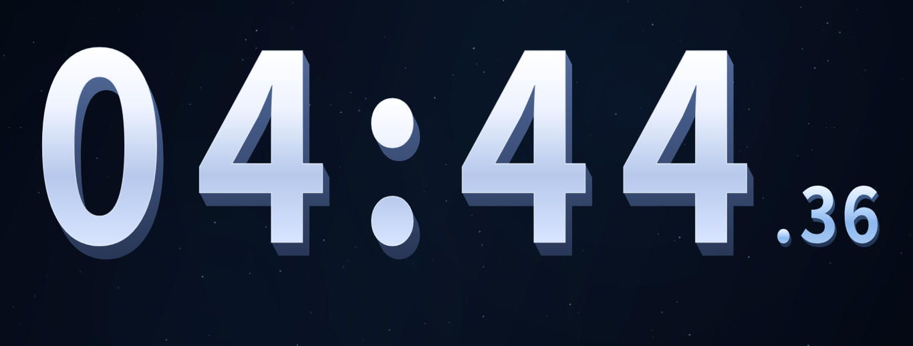
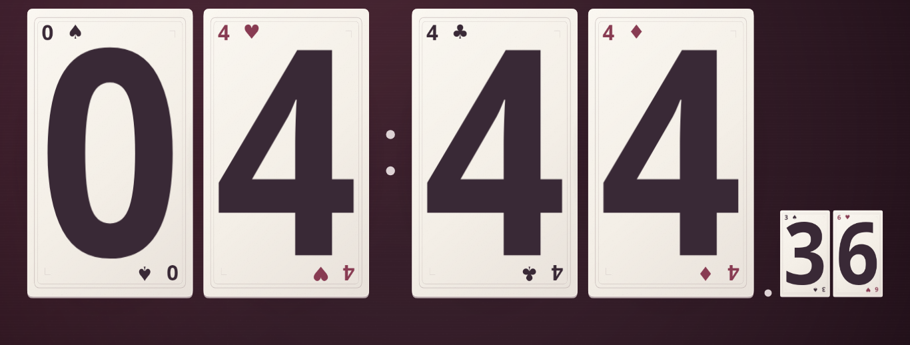

# 晴窗教室

三个共享名单的点名主题：晴窗教室、星空卡片、翻牌点名；带 1–10 分钟背书倒计时（默认 2 分钟，平铺按钮选择）。

本目录是网页 v96 的独立源码快照，基准提交 `365796b4493178fdee6cf4b68b60621d1fdef810`。不含原托管仓库历史、托管身份配置、真实学生名单、用户截图或桌面运行时。

## 场景预览

以下六张图片使用本次源码的原生 Canvas / 软件渲染路径生成，展示演示名单下的点名与倒计时场景。它们不是浏览器整页截图，不包含底部操作栏，也不代表浏览器 GPU 或触摸布局验收。倒计时标题已移除；三主题主数字按相同实际可见字高适度放大并上移，“时间到”也采用统一的可见字高。各主题保留自己的材质，纸牌保留完整双边框。

### 晴窗教室

点名场景：


倒计时场景：


### 星空卡片

点名场景：


倒计时场景：



### 翻牌点名

点名场景：


倒计时场景：



班级与座位编辑器属于浏览器 DOM 界面，本次未取得可验证的浏览器截图，未以模拟图替代。可运行网页后点击“班级与座位”查看。

## 运行网页

网页为原生 HTML / CSS / JavaScript ES modules，无编译步骤，无需 npm 安装。`dist/` 就是可部署的源码及静态资源目录，代码依赖已本地随包提供。本快照包含用户提供并授权用于本项目的点名音频；文件字节不变，仅采用中性文件名。详情见 `ASSET_SOURCES.md`。

使用 Python 3 在项目根目录运行：

```sh
python3 -m http.server 8000 --bind 127.0.0.1 --directory dist
```

打开 `http://127.0.0.1:8000`。不要直接双击 HTML：ES modules 和模型读取需要 HTTP 服务。可把整个 `dist/` 放到支持静态文件的服务器；无需数据库或服务端 API。

## 验证

建议 Node.js 24。测试使用 Node 内置模块、随包 Three.js 和确定性 DOM/时钟/声音夹具，无外部测试依赖。

```sh
node scripts/test.mjs
```

这些测试覆盖状态、计时、随机候选、数据往返、模型投影与渲染结构，不能替代 Windows / 浏览器 GPU、音频设备和触摸屏实测。

## 数据与行为

- 班级、姓名、座位及偏好保存在浏览器本机 localStorage，不上传名单。
- 已点集合仅存在本次文档会话，各班独立；刷新/重开清空已点集合，切主题或重复模式不会清空。
- 不重复模式耗尽后提示停止；允许重复期间也记录已点集合。
- 编辑器与新版 Excel 导出均采用老师视角：后排在上，第一排及讲台在下，左右按老师所见。座位 row/col 与学生身份不变；新版网页仍可导入旧 v1/v2 Excel。新版 v3 Excel 请用新版网页导入，旧版程序会安全拒绝，避免读反座位。
- 空班主按钮显示“添加学生”，直接打开当前班级座位编辑器；保存成功会显示班级名与已保存人数。
- 教室抽取 1 秒，星空完整旋转 1 秒（总过程 1.75 秒），翻牌单次翻开 0.6 秒。倒计时依实际时间戳推进。
- 中文姓名播报依赖系统可用的本地中文语音，读音可能存在多音字差异。

## 目录

- `dist/`：完整网页源码和离线运行资源
- `tests/`：生产逻辑回归测试与测试夹具
- `scripts/test.mjs`：跨平台顺序运行测试
- `desktop/`：桌面包装配置及构建说明（不含 Electron 二进制）
- `ASSET_SOURCES.md`：第三方来源和分发注意事项
- `SOURCE_MANIFEST.json`：本快照文件大小与 SHA-256 清单

本项目没有新增项目级开源许可证。第三方组件继续适用各自许可证；用户提供素材的使用授权不代表对公众授予额外开放许可证。不要把名单、班级备份、截图、浏览器资料目录或密钥提交到仓库。
